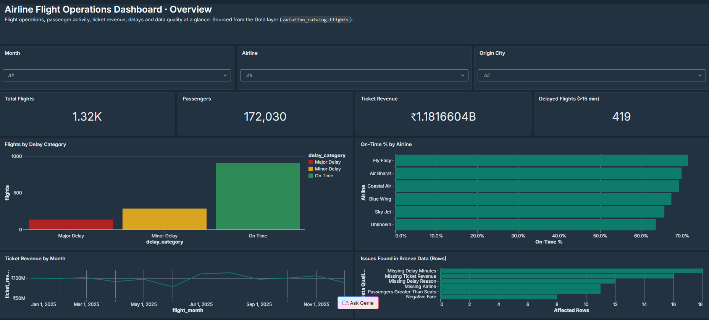
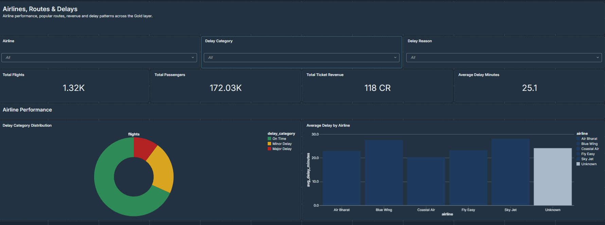
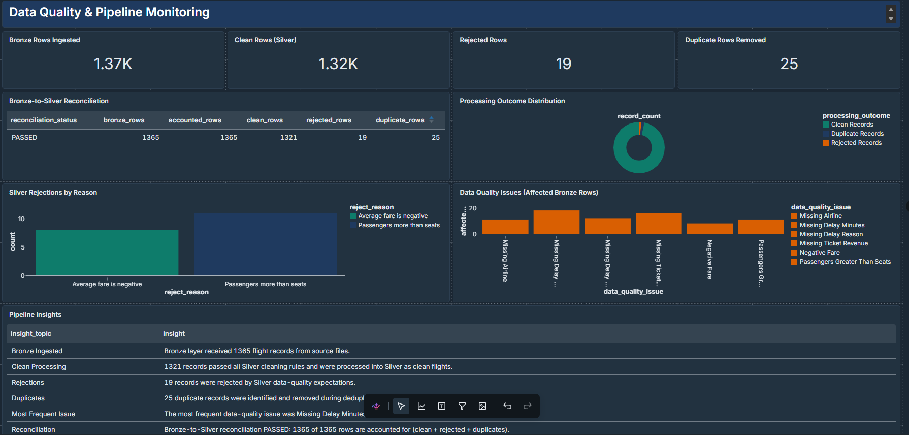
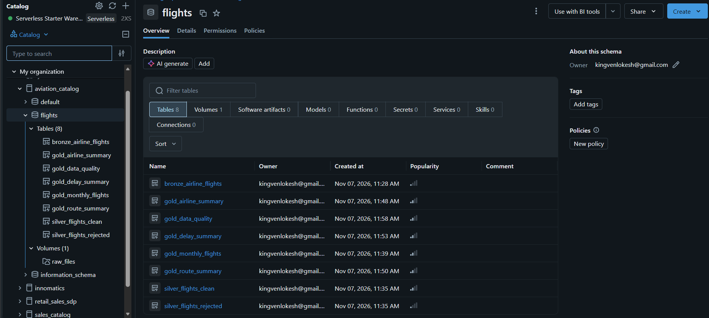

# ✈️ Airline Flight Operations Analytics Platform

### End-to-End Data Engineering Project | Databricks | Lakeflow Spark Declarative Pipelines | SQL

<p align="center">
  <strong>Transforming raw airline flight data into clean, reliable and business-ready insights.</strong>
</p>

---

## 📌 Project Overview

The **Airline Flight Operations Analytics Platform** is an end-to-end Data Engineering project built using **Databricks and Lakeflow Spark Declarative Pipelines**.

The project processes raw airline flight data through the Medallion Architecture (Bronze, Silver and Gold), applies data cleansing and quality checks, and generates business-ready analytical tables.

The final outputs help analyze airline performance, flight delays, passenger trends, route performance and ticket revenue through interactive dashboards.

## 🎯 Project Objectives

- Build a structured data pipeline using Medallion Architecture.
- Ingest raw airline flight data into the Bronze layer.
- Clean and validate records in the Silver layer.
- Identify and separate rejected records.
- Generate aggregated business insights in the Gold layer.
- Implement data-quality checks and reconciliation.
- Build interactive dashboards for operational analysis.

## 🏗️ Data Architecture

The project follows the **Medallion Architecture**.


### Data Flow

```text
       Raw Airline CSV Data
                |
                ▼
        BRONZE LAYER
       Raw Data Ingestion
                |
                ▼
        SILVER LAYER
      Data Cleaning & Validation
           /         \
          ▼           ▼
    Clean Records   Rejected Records
          |
          ▼
         GOLD LAYER
     Business Aggregations
          |
          ▼
    AI/BI Dashboard
          |
          ▼
    Business Insights
```

## 🛠️ Technology Stack

| Technology | Purpose |
|---|---|
| Databricks | Data Engineering Platform |
| Lakeflow Spark Declarative Pipelines | Data Pipeline Development |
| SQL | Data Transformation |
| Medallion Architecture | Data Organization |
| CSV | Source Data Format |
| Databricks AI/BI Dashboards | Data Visualization |
| Git & GitHub | Version Control |

## 📂 Project Structure

```text
Airline-Flight-Operations-Analytics/
│
├── DASHBOARD/
│   ├── page_1_overview.png.png
│   ├── page_2_airlines_routes_delays.png.png
│   └── page_3_data_quality.png.png
│
├── Data/
│   └── airline_flights_raw.csv
│
├── ETL PIPELINE/
│   ├── bronze_airline_flights/
│   │   └── bronze_airline_pipeline/
│   │       └── bronze_transformations/
│   │           └── Bronze_transformation.sql
│   │
│   ├── Silver_airline_flights/
│   │   └── Silver_airline_pipeline/
│   │       └── Silver_transformations/
│   │           └── Silver_transformation.sql
│   │
│   └── Gold_airline_flights/
│       └── Gold_airline_pipeline/
│           └── Gold_transformations/
│               └── Gold_transformation.sql
│
├── Images/
│   ├── Medallion View.png
│   └── catalog_structure.png.png
│
└── .gitignore
```

## ⚙️ Data Engineering Workflow

### 🥉 1. Bronze Layer – Raw Data Ingestion

**Table:** `bronze_airline_flights`

The Bronze layer stores raw airline flight records ingested from CSV files.

Key operations:
- Read CSV files from Databricks Volumes.
- Preserve the original source columns.
- Capture source file information.
- Add ingestion timestamps.
- Maintain the raw data for downstream processing.

### 🥈 2. Silver Layer – Data Cleaning & Transformation

**Tables:**
- `silver_flights_clean`
- `silver_flights_rejected`

The Silver layer improves data quality and prepares reliable records for analysis.

Key transformation rules:

- Remove duplicate records using `flight_id`.
- Standardize text fields using trimming and proper capitalization.
- Handle missing airline and delay-reason values.
- Calculate missing delay durations using scheduled and actual departure timestamps.
- Calculate missing ticket revenue using passengers and average fare.
- Identify invalid passenger counts and negative ticket fares.
- Separate rejected records with appropriate rejection reasons.
- Classify flights based on delay duration.

**Delay Classification**

| Delay Duration | Category |
|---|---|
| 0–15 minutes | On Time |
| 16–60 minutes | Minor Delay |
| Above 60 minutes | Major Delay |

### 🥇 3. Gold Layer – Business Analytics

The Gold layer generates aggregated tables for business reporting and dashboard development.

| Gold Table | Business Purpose |
|---|---|
| `gold_monthly_flights` | Monthly flight and revenue trends |
| `gold_airline_summary` | Airline performance analysis |
| `gold_route_summary` | Route-level performance |
| `gold_delay_summary` | Flight delay analysis |
| `gold_data_quality` | Data quality and reconciliation metrics |

## 📊 Data Quality & Reconciliation

Data quality is an important part of this project.

The pipeline evaluates duplicates, missing values, invalid passenger counts, negative fares and other data-quality conditions.

### Data Processing Results

| Metric | Records |
|---|---:|
| Bronze Records | 1,365 |
| Duplicate Records | 25 |
| Clean Records | 1,321 |
| Rejected Records | 19 |

### Reconciliation Check

The project validates the following condition:

```text
Bronze Records = Clean Records
                 + Rejected Records
                 + Duplicate Records
```

```text
1,365 = 1,321 + 19 + 25
```

**Reconciliation Status: PASSED ✅**

This confirms that the Bronze records are accounted for across the clean, rejected and duplicate categories.

## 📈 Dashboard & Business Insights

The project includes three dashboard pages designed to provide a comprehensive view of airline operations.

### 1. Overview Dashboard



Focus areas:
- Total flights
- Total passengers
- Ticket revenue
- Delayed flights
- Monthly revenue trends
- On-time performance by airline

### 2. Airlines, Routes & Delays



Focus areas:
- Airline performance comparison
- Load factor and on-time percentage
- Top 10 routes by revenue
- Flights by delay category
- Delay reasons analysis

### 3. Data Quality Dashboard



Focus areas:
- Bronze, clean and rejected records
- Duplicate records
- Data-quality issues
- Reconciliation status
- Data-quality problem counts

## 🗂️ Databricks Catalog Structure

**Catalog:** `aviation_catalog`  
**Schema:** `flights`  
**Volume:** `raw_files`

**Source File Location:**

```text
/Volumes/aviation_catalog/flights/raw_files/
```



## 🚀 How to Run the Project

Follow these steps to reproduce the pipeline:

**Step 1:** Create a catalog named `aviation_catalog`.

**Step 2:** Create a schema named `flights`.

**Step 3:** Create a volume named `raw_files`.

**Step 4:** Upload `airline_flights_raw.csv` into the volume.

**Step 5:** Import the Bronze, Silver and Gold SQL transformation files into Databricks.

**Step 6:** Configure the Lakeflow Spark Declarative Pipelines workflow with the required transformations.

**Step 7:** Run the pipeline and validate the Bronze, Silver and Gold tables.

**Step 8:** Verify the data-quality reconciliation results.

**Step 9:** Connect the Gold tables to the dashboard and review the analytical outputs.

## 💡 Key Learnings

Through this project, I gained practical experience in:

- Building data pipelines in Databricks.
- Implementing Medallion Architecture.
- Working with Lakeflow Spark Declarative Pipelines.
- Writing SQL transformations.
- Performing data cleaning and validation.
- Handling duplicates and rejected records.
- Implementing data-quality checks.
- Creating business-ready Gold tables.
- Developing dashboards for operational insights.
- Managing project code using Git and GitHub.

## 🔮 Future Enhancements

- Automate scheduled data ingestion.
- Integrate real-time flight data sources.
- Implement advanced delay prediction models.
- Add automated pipeline monitoring and alerting.
- Extend analytics with additional operational KPIs.

## 👨‍💻 Author

**Dharmana Lokesh**

Aspiring Data Engineer | Data Analytics | Python | SQL | Databricks | ETL | AWS

📌 **GitHub:** [Dharmanalokesh](https://github.com/Dharmanalokesh)

---

<p align="center">
  <strong>⭐ If you find this project interesting, consider giving this repository a star!</strong>
</p>

<p align="center">
  <i>Built with curiosity, continuous learning and a passion for Data Engineering.</i>
</p>
